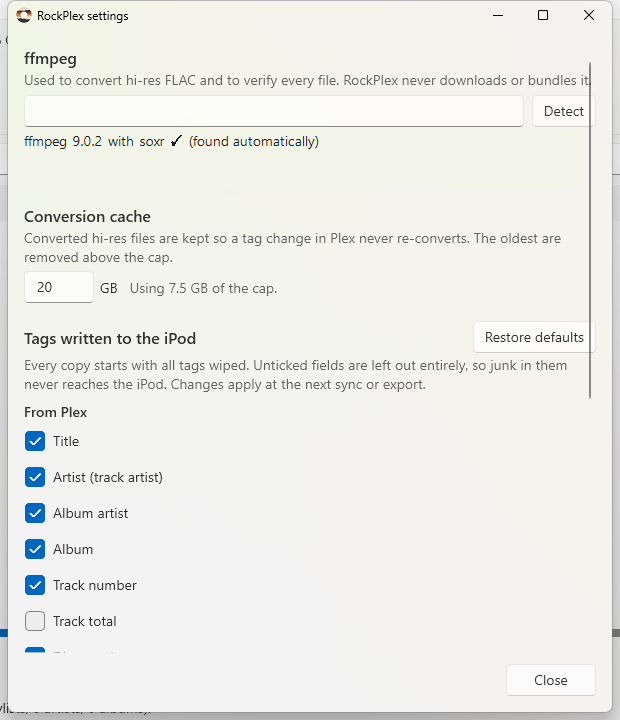

# RockPlex

**Your Plex music library on an iPod running Rockbox, exactly as Plex shows it.**

RockPlex is a Windows app that syncs music from a Plex Media Server to an iPod 5.5G (Video) running [Rockbox](https://www.rockbox.org). Pick playlists, artists and albums (or everything), press **Sync**, and the iPod ends up with the same titles, artists, album art and playlists you see in Plex. Each sync only changes what's different.


## Features

### Choose what goes on the iPod
- **All songs**, or any mix of **playlists**, **artists** and **albums**. Ticking an album and its artist costs nothing extra; every track is stored once.
- A **live capacity bar** shows how much of the iPod your selection fills, before anything is copied. Hi-res albums are sized as they'll be *after* conversion.
- Selections are remembered, and saved on the iPod too, so it carries its own setup to any PC.

### Playlists that never break
- Selecting a playlist brings **all** of its tracks along. A playlist is never half-copied and never points at a missing song.
- Plex's **order and duplicates are kept**. Smart playlists are refreshed on every sync.
- Your **own playlists and files on the iPod are never touched**; RockPlex only manages what it created.

### Sound quality without waste
- **Hi-res FLAC** (24-bit, 48–192 kHz) is converted down to **16-bit / 44.1 kHz** with a high-quality resampler (soxr) and dither. The iPod's hardware can't play above 48 kHz anyway, so this saves space and battery.
- Nothing is ever **upsampled**. CD-quality FLAC, MP3, AAC and everything else is copied **bit-for-bit**; only the tags and artwork change.
- Gapless information in AAC files is preserved.

### Clean tags and artwork from Plex
- Plex is the source of truth: messy tags in your files are **wiped**, and one clean set is written from Plex's metadata. That's only on the iPod copies; your server files are never modified.
- Choose **exactly which tags** are written. Don't use genres? Switch them off, and the same for comments, composers, totals and more.
- Album art from Plex, embedded in every track and saved as `cover.jpg` for Rockbox's PictureFlow (baseline JPEG, the format Rockbox can show).



### Syncs you can trust
- **See the plan first:** what will be added, updated, moved and removed, and the free space afterwards. Nothing changes until you confirm.
- **Every file is verified** by reading it back from the iPod before it replaces anything.
- **Safe to unplug** or stop at any time: the next sync picks up where it left off.
- **Fast repeat syncs:** unchanged tracks are skipped, a Plex edit only rewrites the tags it affects, and converted hi-res files are cached on the PC.
- **Test export** writes the processed files to a folder on your PC, if you want to see the results before syncing.

## Getting started

**You'll need**
- Windows 10 or 11, and the [.NET 10 SDK](https://dotnet.microsoft.com/download) to build it (there's no installer yet)
- A Plex Media Server with a music library
- An iPod 5.5G (Video) with Rockbox, connected in disk mode
- **ffmpeg** with soxr: `winget install Gyan.FFmpeg`. RockPlex finds it automatically.

**Run it**
```bash
git clone https://github.com/hyprninja/RockPlex.git
cd RockPlex
dotnet run --project src/RockPlex.App
```

1. **Sign in with Plex.** Your browser opens Plex's own sign-in page; RockPlex never sees your password.
2. RockPlex finds your server and loads your music library.
3. Plug in the iPod. It appears with its free space.
4. Tick what you want and watch the capacity bar.
5. Press **Sync**, check the plan, and start. When it's done, run **Database → Update Now** on the iPod.

**Tip:** in Rockbox, set *Settings → General Settings → Playlists → Playlist Viewer Settings → Track Display* to **Title from ID3 tags** (or **Title & Album**). Playlists then show song titles instead of file names.

## Roadmap
- [x] Plex sign-in, library browsing, capacity planning
- [x] Media pipeline: conversion, clean tags, artwork
- [x] Sync engine with verified copies and unbreakable playlists
- [ ] Play counts and ratings from the iPod back to Plex
- [ ] Tray icon, automatic sync when the iPod is plugged in, Last.fm scrobbling

## Privacy and security
- Your Plex token is stored encrypted for your Windows account (DPAPI) and is never written to logs. Your **account** token only ever goes to plex.tv over HTTPS; your server only receives its own access token.
- If your router blocks Plex's secure `plex.direct` addresses, RockPlex falls back to plain HTTP on your local network, so the server token travels unencrypted there. Enter an `https://` address under **Server address** in the main window to avoid that.
- RockPlex only writes to `/Music`, `/Playlists` and its own `/.rockplex` folder on the iPod, and treats everything it reads from the iPod as untrusted.

## For developers
```bash
dotnet build RockPlex.slnx -c Debug
dotnet test  RockPlex.slnx
```
.NET 10, WPF with the Fluent theme, CommunityToolkit.Mvvm, TagLibSharp and ffmpeg. Design notes and milestone plans are in [`docs/`](docs/) and [`CLAUDE.md`](CLAUDE.md).

<details>
<summary>Project layout</summary>

| Project | What it does |
|---|---|
| `src/RockPlex.Core` | Models, format policy, size estimates, selection, tag mapping, sync planner, fit check, playlist writer. No packages, no I/O. |
| `src/RockPlex.Plex` | Plex sign-in, server discovery, library and playlist reads. |
| `src/RockPlex.Device` | Rockbox detection, on-iPod state (`/.rockplex/`), verified copies, playlist checks. |
| `src/RockPlex.Media` | Download, conversion (ffmpeg/soxr), tag rewrite (TagLibSharp), artwork (WIC), verification, Test export, sync engine. |
| `src/RockPlex.App` | The WPF app. |
| `tests/RockPlex.Tests` | xUnit tests, including end-to-end syncs against a temporary folder standing in for the iPod. |

App data lives in `%LOCALAPPDATA%\RockPlex\` (settings, encrypted token, logs and a conversion cache capped at 20 GB).
</details>
