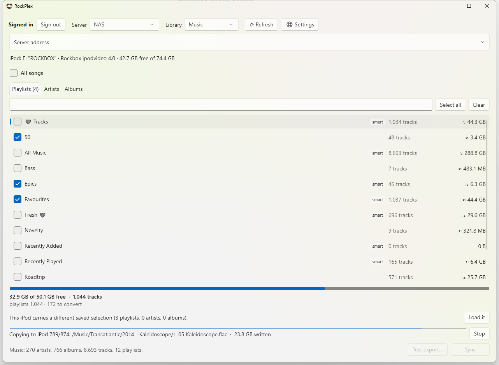

# PlexPod

**Your Plex music library on a classic iPod, exactly as Plex shows it, on Apple's own firmware or Rockbox.**

PlexPod is a Windows app that syncs music from a Plex Media Server to an iPod. Plug the iPod in and PlexPod works out what it runs: **Apple's stock firmware** (so it keeps working with your car and other iPod accessories) or **[Rockbox](https://www.rockbox.org)**. It was built and tested on an **iPod 5.5G (Video)**; see [Which iPods work](#which-ipods-work) for the rest. Pick playlists, artists and albums (or everything), press **Sync**, and the iPod ends up with the same titles, artists, album art and playlists you see in Plex. Each sync only changes what's different, and plays and ratings from the iPod flow back to Plex.



## Features

### Apple firmware or Rockbox, detected automatically
- **Apple's firmware (iPod OS 1.3):** PlexPod writes the iPod's own library database, the way iTunes did, so artists, albums, playlists and covers show in the iPod's menus and in **car stereos and docks** that talk to iPods. No iTunes needed.
- **Rockbox:** music in plain artist/album folders with `.m3u8` playlists, for Rockbox's database and file browser.
- PlexPod tells them apart by what's on the iPod and runs the matching sync. Switch firmware and the next sync tidies up what it wrote for the other one.

### Choose what goes on the iPod
- **All songs**, or any mix of **playlists**, **artists** and **albums**. Ticking an album and its artist costs nothing extra; every track is stored once.
- A **live capacity bar** shows how much of the iPod your selection fills, before anything is copied. Hi-res albums are sized as they'll be *after* conversion.
- Selections are remembered, and saved on the iPod too, so it carries its own setup to any PC.

### Playlists that never break
- Selecting a playlist brings **all** of its tracks along. A playlist is never half-copied and never points at a missing song: if a track fails to copy, the playlist keeps its previous version.
- Plex's **order and duplicates are kept**. Smart playlists are refreshed on every sync.
- Your **own files and playlists on the iPod are never touched**; PlexPod only manages what it created.

### Sound quality without waste
- **Hi-res FLAC** (24-bit, 48–192 kHz) is converted down to **16-bit / 44.1 kHz** with a high-quality resampler (soxr) and dither. The iPod's hardware can't play above 48 kHz anyway, so this saves space and battery.
- **On Apple's firmware**, which can't play FLAC, it becomes **Apple Lossless**: still lossless, checked sample for sample against the FLAC, and about the same size.
- Nothing is ever **upsampled**. MP3 and AAC are copied **bit-for-bit**; only the tags and artwork change. Gapless information in AAC files is preserved.

### Clean tags and artwork from Plex
- Plex is the source of truth: messy tags in your files are **wiped**, and one clean set is written from Plex's metadata. That's only on the iPod copies; your server files are never modified.
- Choose **exactly which tags** are written. Don't use genres? Switch them off, and the same for comments, composers, totals and more.
- Album art from Plex: in the iPod's own artwork database on Apple's firmware, and embedded plus `cover.jpg` for Rockbox's PictureFlow.


### Plays and ratings back to Plex
- Tracks you play on the iPod (or from the car) count as plays in Plex, and ratings you set on the iPod show up there too, at every sync.
- On Apple's firmware the iPod's own counts are kept and carried into every new library. On Rockbox, turn on *Logging* and plays come from its playback log.
- If Plex can't be reached, nothing is lost: plays wait for the next sync. A setting decides whether ratings from the iPod replace Plex's or only fill gaps.

### Syncs you can trust
- **See the plan first:** what will be added, updated, moved and removed, and the free space afterwards. Nothing changes until you confirm.
- **Every file is verified** by reading it back from the iPod before it replaces anything. The iPod's library database is rebuilt in full, checked, and swapped in only when complete.
- **Safe to unplug** or stop at any time: the next sync picks up where it left off.
- **Fast repeat syncs:** unchanged tracks are skipped, a Plex edit only rewrites the tags it affects, and converted files are cached on the PC.
- **Test export** writes the processed files to a folder on your PC, if you want to see the results before syncing.

## Which iPods work

PlexPod was built and tested on an **iPod 5.5G (Video)**, with both Apple's firmware and Rockbox.

Apple's firmware only shows music listed in the iPod's library database. From late 2007, Apple's firmware requires that database to carry a cryptographic signature ("hash58", tied to each iPod). PlexPod doesn't create that signature, so on those models it needs Rockbox, which reads the music folders directly.

| iPod | Apple firmware | Rockbox |
|---|---|---|
| **iPod 5G / 5.5G (Video)**, 2005–2006 | ✅ Built and tested here (iPod OS 1.3) | ✅ Built and tested here |
| iPod 1G–4G, Photo/Color, mini 1G/2G, nano 1G/2G, 2001–2006 | Should work: no signature needed. Untested, and covers use the iPod Video's thumbnail sizes, so they may not show | Should work wherever Rockbox runs (untested) |
| **iPod Classic 6G / 6.5G / 7G** (80, 120, 160 GB), 2007–2009 | ❌ Needs the signed database | ✅ Use Rockbox, which runs on the Classic (untested with PlexPod) |
| iPod nano 3G / 4G, 2007–2008 | ❌ Needs the signed database | ❌ No Rockbox port |
| iPod nano 5G and later, shuffle, touch | ❌ Newer database formats | ❌ No Rockbox port |

The signature has been worked out (libgpod can write it), so native support for the Classic is possible later. iPods have to be formatted for Windows (FAT32): an iPod formatted on a Mac won't appear in Windows.

## Getting started

**You'll need**
- Windows 10 or 11, and the [.NET 10 SDK](https://dotnet.microsoft.com/download) to build it (there's no installer yet)
- A Plex Media Server with a music library
- An iPod that works with PlexPod (see [Which iPods work](#which-ipods-work)), connected in disk mode
- **ffmpeg** with soxr: `winget install Gyan.FFmpeg`. PlexPod finds it automatically.

**Run it**
```bash
git clone https://github.com/hyprninja/PlexPod.git
cd PlexPod
dotnet run --project src/PlexPod.App
```

1. **Sign in with Plex.** Your browser opens Plex's own sign-in page; PlexPod never sees your password.
2. PlexPod finds your server and loads your music library.
3. Plug in the iPod. It appears with its firmware and free space.
4. Tick what you want and watch the capacity bar.
5. Press **Sync**, check the plan, and start. When it's done:
   - **Apple firmware:** eject the iPod and unplug it; the new library is there straight away.
   - **Rockbox:** run **Database → Update Now** on the iPod.

**On Apple's firmware,** don't let iTunes sync the iPod: it would replace PlexPod's library with its own. Keep iTunes closed while the iPod is plugged in (or set it to *Manually manage music*).

**On Rockbox,** set *Settings → General Settings → Playlists → Playlist Viewer Settings → Track Display* to **Title from ID3 tags** (or **Title & Album**) so playlists show song titles instead of file names.

## Roadmap
- [x] Plex sign-in, library browsing, capacity planning
- [x] Media pipeline: conversion, clean tags, artwork
- [x] Sync engine with verified copies and unbreakable playlists
- [x] Play counts and ratings from the iPod back to Plex
- [x] Apple's stock firmware alongside Rockbox, detected automatically
- [ ] Covers on older iPods' Apple firmware (their thumbnail sizes)
- [ ] Apple's firmware on the iPod Classic (the signed "hash58" database)
- [ ] Tray icon, automatic sync when the iPod is plugged in, Last.fm scrobbling

## Privacy and security
- Your Plex token is stored encrypted for your Windows account (DPAPI) and is never written to logs. Your **account** token only ever goes to plex.tv over HTTPS; your server only receives its own access token.
- If your router blocks Plex's secure `plex.direct` addresses, PlexPod falls back to plain HTTP on your local network, so the server token travels unencrypted there. Enter an `https://` address under **Server address** in the main window to avoid that.
- The only writes PlexPod makes to Plex are plays and ratings.
- On the iPod, PlexPod only writes to its own music and playlist folders (`/Music` and `/Playlists` for Rockbox; `iPod_Control/Music` and `iPod_Control/Artwork` for Apple's firmware), the iPod's library database, and its own `/.plexpod` folder. It treats everything it reads from the iPod as untrusted.

## For developers
```bash
dotnet build PlexPod.slnx -c Debug
dotnet test  PlexPod.slnx
```
.NET 10, WPF with the Fluent theme, CommunityToolkit.Mvvm, TagLibSharp and ffmpeg. The iPod database format follows [libgpod](https://github.com/gtkpod/libgpod). Design notes and milestone plans are in [`docs/`](docs/) and [`CLAUDE.md`](CLAUDE.md).

<details>
<summary>Project layout</summary>

| Project | What it does |
|---|---|
| `src/PlexPod.Core` | Models, format policy, size estimates, selection, tag mapping, sync planner, fit check, playlist writer, iTunesDB and ArtworkDB writer and reader, Play Counts, play-log parsing. No packages, no I/O. |
| `src/PlexPod.Plex` | Plex sign-in, server discovery, library and playlist reads, play and rating write-back. |
| `src/PlexPod.Device` | iPod detection (Apple firmware or Rockbox), on-iPod state (`/.plexpod/`), verified copies, playlist checks, Rockbox log reading. |
| `src/PlexPod.Media` | Download, conversion (ffmpeg/soxr, Apple Lossless), tag rewrite (TagLibSharp), artwork (WIC), verification, Test export, sync engine, stats return. |
| `src/PlexPod.App` | The WPF app. |
| `tests/PlexPod.Tests` | xUnit tests, including end-to-end syncs against a temporary folder standing in for the iPod. |

App data lives in `%LOCALAPPDATA%\PlexPod\` (settings, encrypted token, logs, play history and a conversion cache capped at 20 GB).
</details>
