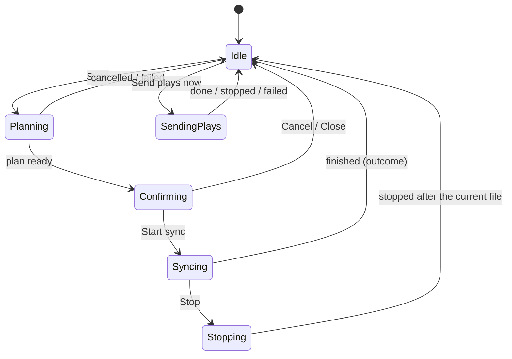
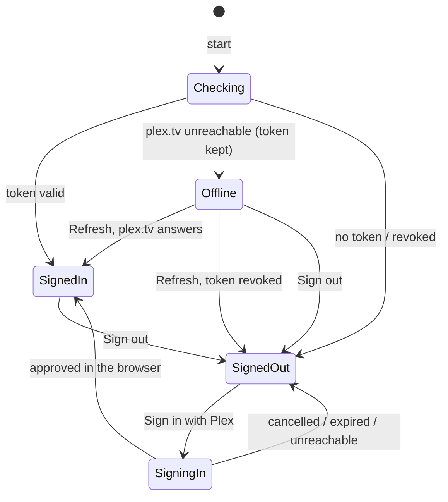
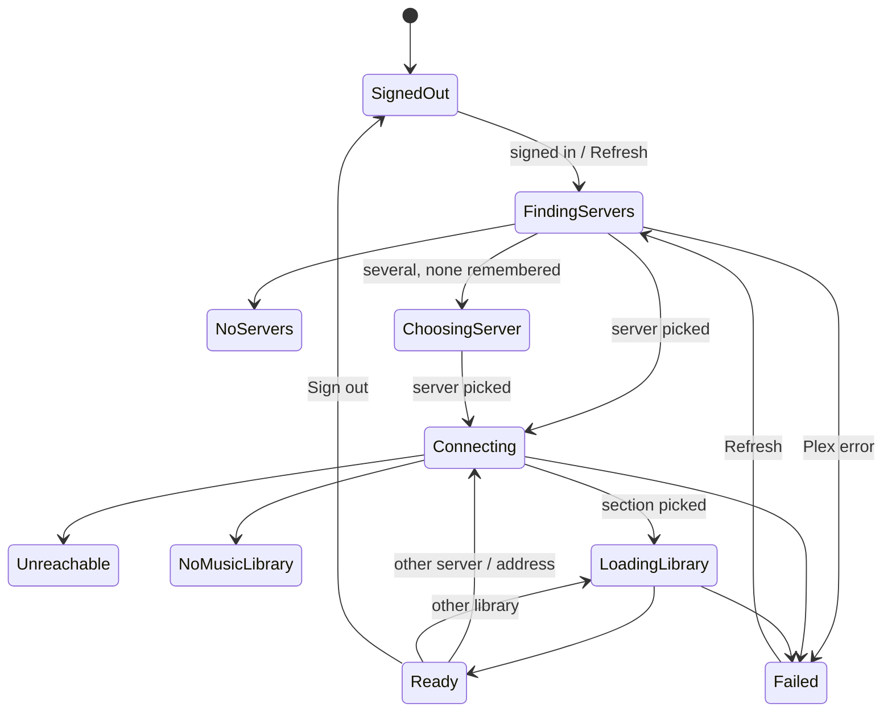

# State machines in PlexPod

Every workflow in PlexPod moves through states. This file lists all of them: where each one's state
lives, its states and transitions, and whether it is **explicit** (one enum, changed in one place) or
deliberately left as it is. Read it before changing a workflow; update it in the same change.

**The rule (14 Nov 2026):** a workflow whose state is spread over several flags, nullable fields or
free text gets one explicit enum and one place that changes it, and the old flags are derived from
it. The text the user sees comes from the state, never the other way round. Persisted state on the
iPod is already explicit by design (manifest, journal, stats bookmarks) and is not refactored for
style: it is safety-critical and tested end to end.

Why: the user always sees an honest status ("Stopping after this file…", not silence), developers
get one switch to read instead of five flags to correlate, and an agent can answer "what can happen
next?" from an enum and this page instead of reconstructing it from string assignments.

| # | Workflow | Where | Before | Now |
|---|---|---|---|---|
| 1 | Sync activity | `SyncViewModel.Activity` (`SyncActivity`) | `SyncCommand.IsRunning` + `ProgressText` + the gate's holder string; no "stopping" state | explicit |
| 2 | Sync outcome | `SyncResult.Outcome` (`SyncOutcome`) | `Completed` and `Stopped` booleans (one combination impossible) | explicit; the booleans are derived |
| 3 | Sync phase | `SyncProgress.Phase` (`SyncPhase`) | free-text phase names | explicit; same text on screen (`SyncPhases.Describe`) |
| 4 | Sign-in | `SignInViewModel.State` (`SignInState`) | `IsSignedIn` + nullable `Username` + `Status` text; "offline" looked like "signed in" | explicit; `IsSignedIn`/`IsSignedOut` derived |
| 5 | Plex library | `MainViewModel.Stage` (`LibraryStage`) | `IsBusy` + `StatusText` + `ConnectionText` (empty = not connected) + nullable snapshot | explicit, alongside the existing text |
| 6 | ffmpeg | `SettingsViewModel.FfmpegState` (`FfmpegState`) | nullable `Ffmpeg` meant both "not looked yet" and "missing"; "no soxr" unhandled | explicit; one detection at a time; the sync plan warns when soxr is missing |
| 7 | Operation gate | `OperationGate.Holder` | label string | left: a mutex with a label, nothing to model |
| 8 | Device watcher | `DeviceWatcher` | `_loop`/`_cts` null = stopped | left: two states, guarded by a lock |
| 9 | Re-entrancy guards | `ServerViewModel._quiet`, `PickerListViewModel._suppress`, `SelectionViewModel._restoring`, `SettingsViewModel._loading` | bool/int flags | left: scoped "don't raise events while I set this" guards, not workflows |
| 10 | Track on the iPod | `ManifestTrack.DevicePath` vs `DesiredPath`, `TrackOpKind` | persisted | left: the journal (M3 plan) |
| 11 | Plays and ratings | `StatsState` (bookmarks, pending plays/ratings) | persisted | left: the M4/M6 plans |
| 12 | Stock library | interim database → removals → final database → Play Counts deleted | ordered code in `SyncEngine` | left: the M6 plan §4.5 |
| 13 | Manifest source | `ManifestSource` (None, Current, Previous) | enum | already explicit |
| 14 | Plex PIN sign-in | `PlexAuthService.PollForTokenAsync` | a loop: pending → approved / expired / cancelled | left: one method, fully tested |

## 1. Sync activity

`SyncViewModel.Activity`. One operation at a time (the gate enforces it across sync, export, Send plays now and Eject).

- **Stopping** exists so the user sees that Stop was heard: the engine finishes the file it is copying
  (never leaves half a file), which can take a while for a large FLAC. Progress keeps updating
  underneath, prefixed with "Stopping after the current file…".
- Planning is also stopped by Stop; it never wrote anything.
- `SyncActivities.CanMove(from, to)` is the transition table, tested against the arrows above.
  `MoveTo` logs a move the table doesn't allow rather than throwing, so a modelling slip can never
  break a sync.

## 2. Sync outcome

`SyncResult.Outcome`: **Complete** (everything done, no failures), **Stopped** (the user pressed
Stop; the iPod is consistent), **FinishedWithProblems** (ran to the end or was cut short by an error
or a disconnect; failures listed). `Completed` and `Stopped` remain as derived booleans.

## 3. Sync phase

`SyncPhase`, in the order a sync runs them:

| Phase | Text on screen | Rockbox | Stock |
|---|---|---|---|
| `Preparing` | Preparing | ✓ | ✓ |
| `ReadingPlays` | Reading plays on the iPod | | ✓ (Play Counts) |
| `SendingPlays` | Sending plays to Plex | ✓ (if on) | ✓ |
| `Moving` | Moving | ✓ (renamed in Plex) | ✓ |
| `CheckingTags` | Checking tags | ✓ | ✓ |
| `Copying` | Copying to iPod | ✓ | ✓ |
| `WritingLibrary` | Writing the iPod's library | | ✓ (interim, in make-room mode, and final) |
| `WritingArt` | Writing album art | | ✓ |
| `WritingPlaylists` | Writing playlists | ✓ | |
| `CheckingLibrary` | Checking the iPod's library | | ✓ |
| `CheckingPlaylists` | Checking playlists | ✓ | |
| `Removing` | Removing | ✓ (last; first in make-room mode) | ✓ |
| `Finishing` | Finishing | ✓ | ✓ (saving the manifest) |

## 4. Sign-in

`IsSignedIn` is SignedIn or Offline (the library may still load from a local server); `IsSignedOut`
is SignedOut or SigningIn, which is when the "Sign in with Plex" button shows (not while Checking, so
it doesn't flash at start-up). Re-checking from Offline stays Offline until plex.tv answers, so the
window doesn't flicker. Before this was explicit, Refresh skipped the check whenever a token was in
use, so an offline start never recovered: "Can't reach plex.tv" stayed and the name never appeared.
A failed or cancelled check always ends SignedOut, never stuck in Checking.

## 5. Plex library

`MainViewModel.Stage`. `StatusText` still carries the details (counts, server names, errors).

A newer load always supersedes an older one (its cancellation token), so `Stage` is set only by the load that is still current.

## 6. ffmpeg

`SettingsViewModel.FfmpegState`: **Detecting** → **Missing**, **NoSoxr** (copies and verification
work; FLAC above 44.1 kHz can't be converted) or **Ready**. Detection runs once at a time: a sync or
export that needs ffmpeg while detection is running waits for it instead of starting another. When
ffmpeg has no soxr and the plan holds hi-res FLAC to convert, the sync confirmation says so up front
(those tracks would fail, and playlists holding them keep their previous version).

## Tests

`tests/PlexPod.Tests/App/StateMachineTests.cs` holds one group per explicit machine: the sync activity
table is checked arrow by arrow against §1 (and that no state gets stuck), the outcome mapping, the
phase text (unchanged from before), sign-in with fake Plex answers, and one-at-a-time ffmpeg
detection. `SyncEngineTests.PlanWithHiResFlac_AndNoSoxr_WarnsBeforeTheSync` covers the soxr warning
on a real plan.
